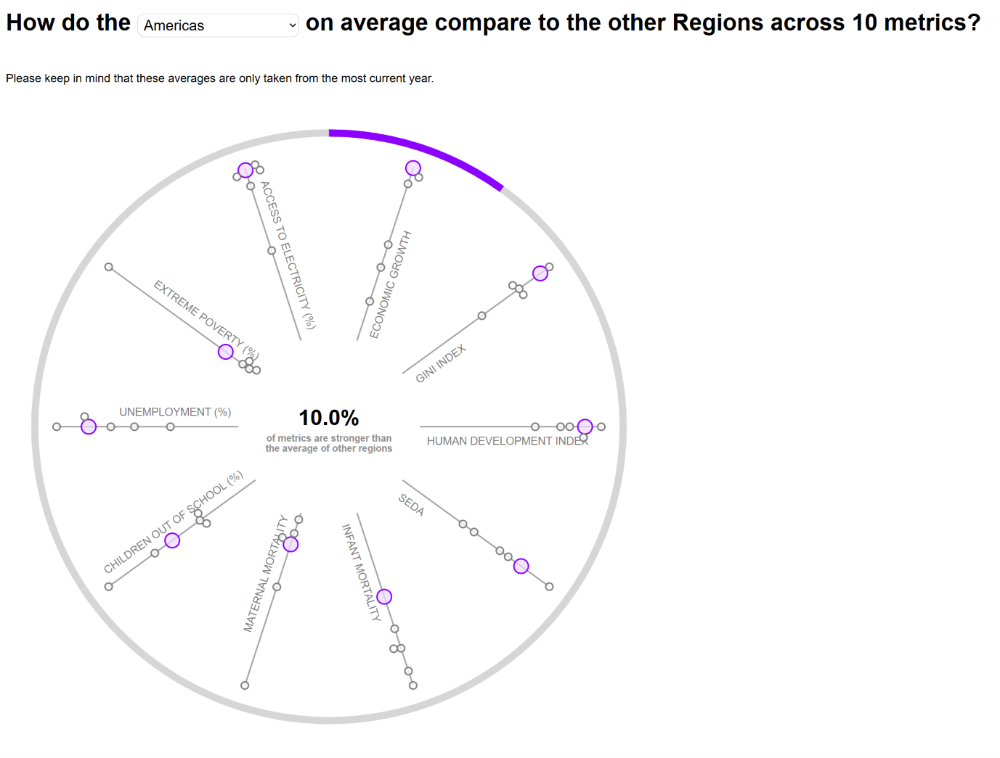

# Regional Development Data Visualization

An interactive D3.js visualization that compares socioeconomic and development indicators across six world regions. Users can select a region to explore its performance across ten different metrics, with visual emphasis on the metrics where the selected region performs best relative to other regions.

## Overview

The visualization uses country-level data aggregated into six geographical regions:

- Americas
- East Asia & Pacific
- Europe & Central Asia
- Middle East & North Africa
- South Asia
- Sub-Saharan Africa

Ten socioeconomic and development indicators are used to compare regional averages, including the GINI Index, Human Development Index (HDI), economic growth, infant mortality, maternal mortality, unemployment, and access to electricity.

The visualization highlights how each region compares across these indicators and identifies the metrics in which a selected region has the highest average among all six regions.

## Data

The dataset is located in `data/data.csv`.

Country-level data is grouped into six regions, and regional averages are calculated for each metric. When multiple years of data are available for an indicator, only the most recent available year's value is used in the calculations.

## Running the Application

This project uses D3.js to generate its visualization and can be run locally using Visual Studio Code and the Live Server extension.

1. Download or clone this repository.
2. Open the project directory in Visual Studio Code.
3. Navigate to the Extensions panel.
4. Search for **Live Server** by Ritwick Dey and install it.
5. Open the project's HTML file.
6. Click **Go Live** in the bottom-right corner of Visual Studio Code.
7. Your browser will automatically open the application. If it does not, navigate to the local address displayed by Live Server (typically `http://localhost:5500`).

## Technologies Used

- HTML
- CSS
- JavaScript
- D3.js

